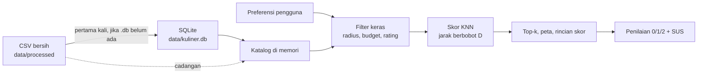

# Sistem Rekomendasi Kuliner KNN Berbasis Lokasi, Harga, Rating, dan Kategori untuk Pengguna Dewasa Muda di Jabodetabek dan Bandung

Aplikasi web yang merekomendasikan tempat makan di Jabodetabek dan Bandung berdasarkan lokasi, anggaran, rating, dan kategori kuliner. Mesinnya memakai *content-based nearest-neighbour retrieval* (KNN jarak berbobot) pada katalog GoFood yang sudah dibersihkan (10.261 merchant).

Tugas Kelompok 2 (TK2) — Sains Data, Program Studi Informatika, Universitas Udayana.

**Status: bagian 6 dari 7** (repositori, dataset, loader SQLite, mesin rekomendasi, antarmuka Streamlit + peta Folium, evaluasi offline, alat evaluasi pengguna, uji black-box, dan persiapan deployment ke Streamlit Community Cloud).

**URL aplikasi (langsung):** _akan diisi setelah deploy, misalnya `https://kuliner-knn.streamlit.app`_

Dosen pengampu: I Made Satria Bimantara, S.Kom., M.Kom.

## Anggota kelompok

| Nama | NIM |
| --- | --- |
| Ketut Indhira Ayu Maheswari | 2408561010 |
| Ida Ayu Prami Suari | 2408561040 |
| Kadek Ezra Mahanaim | 2408561052 |
| I Kadek Dillon Satria Prabawa | 2408561141 |

## Fitur

- Menentukan lokasi lewat kota/kecamatan (centroid), koordinat, atau klik peta (FR-01). GPS browser tidak dipakai (keterbatasan Streamlit).
- Mengisi preferensi: radius 1/3/5/10 km, budget level 1–4, rating minimum, dan kategori (boleh kosong atau lebih dari satu) (FR-02, FR-03).
- Menyaring kandidat (jarak, harga, rating) lalu mengurutkan 10 teratas dengan skor KNN jarak berbobot (FR-04, FR-05).
- Menampilkan daftar, peta Folium, rincian komponen skor, dan tautan Google Maps (FR-07, FR-08); pesan ramah jika hasil kosong (FR-06).
- Mencari merchant berdasarkan potongan nama, dengan filter kota dan hasil berhalaman (FR-09).
- Mengukur waktu respons dan membandingkannya dengan NFR-01 (≤ 2 detik).
- Tab **Evaluasi Pengguna**: penilaian relevansi 0/1/2 dan kuesioner SUS, plus tombol unduh CSV.
- Login dan kelola data admin (FR-10–12) belum dikerjakan (tab Admin masih placeholder).

## Arsitektur dan alur



1. Katalog dibaca dari SQLite. Jika `data/kuliner.db` belum ada (berkas ini diabaikan Git, jadi tidak ikut ke Cloud), aplikasi **membangunnya sendiri** dari `data/processed/gofood_clean.csv`, lalu menyimpannya untuk pemakaian berikutnya.
2. Pengguna mengisi lokasi dan preferensi, lalu menekan **Cari Rekomendasi**.
3. Sistem memfilter kandidat, menghitung skor, dan menampilkan daftar serta peta.
4. Responden dapat menilai hasil dan mengisi SUS; petugas mengunduh CSV sebelum sesi Cloud berakhir.

## Dataset dan sumber

- Sumber: I. Narsa, *GoFood Merchant on Jabodetabek and Bandung*, Kaggle, diambil Februari 2024.
- Tautan: <https://www.kaggle.com/datasets/iannarsa/gofood-merchant-on-jabodetabek-and-bandung>
- Lisensi di halaman Kaggle: **Unknown** (tidak dicantumkan secara spesifik). Data hanya dipakai untuk keperluan akademik nonkomersial, sumbernya selalu disitasi, dan aplikasi tidak menyediakan unduhan massal katalog.
- Isi folder: `data/raw/` (CSV mentah, 10.372 baris) dan `data/processed/` (hasil pembersihan TK1, 10.261 baris; 18 kota, 21 kategori). `data/kuliner.db` tidak diunggah ke Git.

## Metode (skor KNN)

Rekomendasi bersifat *content-based nearest-neighbour retrieval*, bukan klasifikasi. Filter keras: radius Haversine, anggaran (`price_level` ≤ budget), dan rating minimum. Rating 0 pada data mentah berarti **belum dinilai**, bukan rating buruk.

Setiap kandidat diubah menjadi vektor 0–1 (0 = ideal), lalu dihitung jarak Euclidean berbobot ke titik ideal (0, 0, 0, 0):

\[
D = \sqrt{w_\text{lokasi}(d/R)^2 + w_\text{kategori}(1-J)^2 + w_\text{rating} g^2 + w_\text{harga}\bigl((p-1)/3\bigr)^2}
\]

Bobot bawaan (jumlah = 1):

| Komponen | Rumus ringkas | Bobot |
| --- | --- | --- |
| Lokasi | jarak Haversine / radius | 0,35 |
| Kategori | \(1 - \mathrm{Jaccard}\) | 0,30 |
| Rating | selisih satu arah terhadap rating terbaik | 0,20 |
| Harga | \((p-1)/3\) | 0,15 |

Jika pengguna tidak memilih kategori, bobot kategori dinolkan lalu dinormalisasi ulang. Peringkat diurutkan menaik menurut \(D\), lalu jarak, lalu `id` (deterministik).

## Struktur folder

```
kuliner-knn/
  app.py                         antarmuka Streamlit (berkas utama Cloud)
  .streamlit/config.toml         tema hijau, mode headless
  .github/workflows/tests.yml    uji pytest pada push/PR
  data/raw/                      CSV mentah
  data/processed/                CSV bersih (10.261 baris)
  data/evaluasi/                 skenario, templat, contoh (bukan data nyata)
  data/evaluasi/hasil/           jawaban responden (diabaikan Git)
  src/kuliner/                   paket Python (mesin, UI, evaluasi, SUS, DB)
  scripts/load_db.py             membangun data/kuliner.db secara manual
  scripts/demo_rekomendasi.py    contoh kueri Monas / Beji
  scripts/evaluasi_offline.py    evaluasi proksi (bagian 4)
  scripts/hitung_relevansi.py    P@10 / NDCG@10 dari penilaian manusia
  scripts/hitung_sus.py          ringkasan skor SUS
  scripts/uji_black_box.py       tabel black-box (aktual dan status)
  scripts/buat_lembar_penilaian.py
  notebooks/TK2_Evaluasi_Offline.ipynb
  reports/                       luaran evaluasi offline, pengguna, black-box
  docs/evaluasi_pengguna.md      panduan responden dan petugas
  docs/black_box_testing.md      tabel kasus uji black-box
  docs/deployment.md             langkah deploy dan pemecahan masalah
  tests/                         uji pytest
  requirements.txt               dependensi pin
```

Kategori disimpan dua cara: kolom teks `kategori` pada tabel `restoran` (dipisah `|`) dan tabel normalisasi `kategori` + `restoran_kategori`.

## Instalasi dan menjalankan secara lokal

Python 3.10–3.13 (dicoba pada 3.13). Di folder repositori ini.

Membuat lingkungan virtual:

```bash
python -m venv .venv
```

**Windows (Command Prompt)**, termasuk jika Python berasal dari Laragon (pastikan `python` dikenali, atau panggil jalur lengkap seperti `C:\laragon\bin\python\python-3.13\python.exe`):

```bat
.venv\Scripts\activate
python -m pip install --upgrade pip
pip install -r requirements.txt
python scripts\load_db.py
python -m pytest
streamlit run app.py
```

**Windows (PowerShell):**

```powershell
.venv\Scripts\Activate.ps1
python -m pip install --upgrade pip
pip install -r requirements.txt
python scripts\load_db.py
python -m pytest
streamlit run app.py
```

Jika eksekusi skrip dinonaktifkan di PowerShell, jalankan dulu:

```powershell
Set-ExecutionPolicy -Scope Process -ExecutionPolicy Bypass
```

**Linux / macOS:**

```bash
source .venv/bin/activate
python -m pip install --upgrade pip
pip install -r requirements.txt
python scripts/load_db.py
python -m pytest
streamlit run app.py
```

Setelah `streamlit run app.py`, buka alamat yang tampil di terminal (biasanya http://localhost:8501). Form bawaan mengikuti contoh TK1: Kota Depok – Beji, radius 5 km, budget level 2, rating ≥ 4,5, kategori Bakmie. Tekan **Cari Rekomendasi**.

`scripts/load_db.py` bersifat idempotent. Di Cloud (dan juga secara lokal jika `.db` hilang), langkah ini **tidak wajib**: aplikasi akan membangun basis data sendiri pada start pertama.

Demo mesin tanpa antarmuka:

```bat
python scripts\demo_rekomendasi.py
python scripts\demo_rekomendasi.py --contoh beji
```

```python
from kuliner.recommender import rekomendasi

hasil = rekomendasi(
    lat=-6.1754,
    lon=106.8272,
    radius_km=5,
    budget_maks=2,
    rating_min=4.5,
    kategori_pilihan=["Bakmie"],
    k=10,
)
print(hasil[["peringkat", "nama", "jarak_km", "skor"]])
```

## Pengujian

Dari akar repositori, setelah dependensi terpasang:

```bash
python -m pytest
```

Uji mencakup pra-pemrosesan, SQLite, mesin rekomendasi, pembantu UI, AppTest Streamlit, metrik evaluasi, SUS, penilaian, black-box, dan bangun DB otomatis. Alur CI yang sama dijalankan GitHub Actions pada setiap push dan *pull request* (lihat `.github/workflows/tests.yml`).

## Evaluasi offline dan evaluasi pengguna

**Evaluasi offline** (bagian 4) memakai 40 skenario di `data/evaluasi/skenario.csv` dan relevansi *proksi* (bukan penilaian manusia):

```bash
python scripts/evaluasi_offline.py
```

Notebook `notebooks/TK2_Evaluasi_Offline.ipynb` sudah berisi keluaran. Angka proksi tidak boleh diklaim sebagai kualitas akhir.

**Evaluasi pengguna** (bagian 5): tab **Evaluasi Pengguna** menampilkan gabungan Top-10 (urutan acak, tanpa label metode) untuk dinilai 0/1/2, plus kuesioner SUS 10 butir. Setelah sesi:

```bash
python scripts/hitung_relevansi.py
python scripts/hitung_sus.py
```

Berkas `data/evaluasi/contoh_*.csv` adalah **data tiruan** (`--contoh`), bukan hasil responden. Panduan: `docs/evaluasi_pengguna.md`.

Di Streamlit Community Cloud, jawaban di server bersifat sementara. **Unduh CSV** lewat tombol pada tab Evaluasi Pengguna setelah setiap sesi.

## Uji black-box (ringkas)

Rancangan mengikuti Tabel 3.19 laporan TK1. Kasus otomatis (BB-02 sampai BB-10, plus kategori kosong dan NFR-01) dijalankan AppTest. BB-01 (GPS) dilewati; BB-11–14 (admin) ditunda.

```bash
python scripts/uji_black_box.py
```

Tabel lengkap: `docs/black_box_testing.md`.

## Deployment ke Streamlit Community Cloud

Repositori GitHub yang dituju: [Kulacinos/kuliner-knn](https://github.com/Kulacinos/kuliner-knn). Berkas utama: `app.py` di akar repo, cabang `main`.

Langkah singkat (rincian dan pemecahan masalah: `docs/deployment.md`):

1. Pastikan kode sudah ada di GitHub pada cabang `main` (termasuk `app.py`, `requirements.txt`, `src/`, `data/processed/`, `.streamlit/config.toml`). Jangan mengunggah `data/kuliner.db` atau jawaban di `data/evaluasi/hasil/`.
2. Buka <https://share.streamlit.io> dan masuk dengan akun GitHub (izinkan akses ke repositori jika diminta).
3. Klik **Create app** → **Yup, I have an app**.
4. Isi *Repository* `Kulacinos/kuliner-knn`, *Branch* `main`, *Main file path* `app.py`. Opsional: pilih subdomain (URL akan menjadi `https://<subdomain>.streamlit.app`).
5. Buka **Advanced settings**. Pada **Python version**, pilih **3.13** (sesuai pengujian; default Cloud adalah 3.12). Cloud **tidak** memakai `runtime.txt`. Rahasia tidak diperlukan untuk versi ini. Simpan.
6. Klik **Deploy**, lalu tunggu instalasi dependensi. Start pertama juga membangun `kuliner.db` dari CSV (spinner “Menyiapkan basis data…”); ini hanya terjadi jika berkas `.db` belum ada.
7. Jika aplikasi terbuka, salin URL publik ke bagian “URL aplikasi” di README ini.

## Lisensi

Lisensi kode akan ditentukan oleh kelompok (placeholder). Dataset merujuk lisensi sumber di Kaggle (**Unknown**); pemakaian terbatas pada tugas akademik nonkomersial dengan sitasi wajib.
